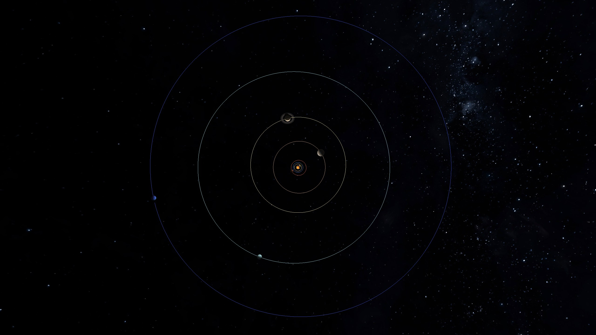
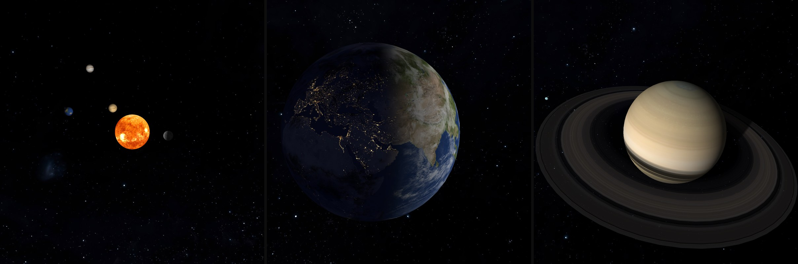

# Solar System Simulation

A real-time 3D simulation of the Sun and its eight planets: gravity is integrated numerically and everything is rendered with OpenGL 3.3 from Python.

*Learning project, developed with Claude Code as a tutor.*



*The whole system from above after 164 simulated years: every orbit trail is complete, even Neptune's. Planet sizes are enlarged for this picture.*



*Left to right: the Sun with the inner planets, Earth (day and night side), Saturn (rings with shadows).*

## What it can do

- **Real gravity:** the Sun and the eight planets (Earth and Moon as one body), start values from NASA/JPL ephemerides, stepped with velocity Verlet at one day per step. The relative energy error after one simulated year is about 5.7 · 10⁻⁸.
- **Planets with textures and light:** every body is lit by the Sun, the Sun itself glows, and each body spins with its real rotation period and axial tilt.
- **Earth:** the day map on the sunlit side, the night map with city lights on the dark side, and optional clouds.
- **Venus:** switch between the atmosphere and the surface map.
- **Saturn:** translucent rings that are lit by the Sun, receive the shadow of Saturn and cast shadows onto the planet.
- **Sky:** a Milky Way background, rotated into the galactic coordinate system so that the band lies where it does in the real sky.
- **Camera and display:** orbit camera, follow any planet, orbit trails, exaggerated or real radii.
- **Time control:** from 30 to 1920 simulated days per second, or pause.

## Requirements

- Python 3.10 or newer (developed with 3.10)
- A GPU and driver with OpenGL 3.3
- Tested only on Windows 11 with an NVIDIA RTX 4070.

## Installation

```
git clone https://github.com/philipp-sz/solar_sim_python.git
cd solar_sim_python
python -m venv .venv
.venv\Scripts\activate
pip install -r requirements.txt
```

## Start

Run it from the project folder:

```
python main.py
```

Optionally, `python energy_demo.py` plots the energy error of the Euler method against velocity Verlet.

## Controls

| Input | Action |
|---|---|
| Mouse drag | rotate the camera around the target |
| Mouse wheel | zoom |
| `1` to `9` | follow Sun, Mercury, Venus, Earth+Moon, Mars, Jupiter, Saturn, Uranus, Neptune |
| `0` | back to the free view around the origin |
| `R` | switch between exaggerated and real radii |
| `C` | switch the limit on the visible rotation speed |
| `T` | Venus only (while following it): atmosphere or surface map |
| `W` | Earth only: clouds on or off |
| `O` | orbit trails on or off |
| `Up` / `Down` | simulated time faster / slower (doubles or halves the speed, from 30 to 1920 days per second; the window title shows the speed) |
| `P` | pause or resume the simulated time |
| `Space` (hold) | inspection mode: the simulation pauses and all bodies rotate slowly |

## Higher-resolution textures (optional)

The repository contains 2K textures. Larger versions are not included. To use them:

1. Download the files listed in [`assets/textures/CREDITS.txt`](assets/textures/CREDITS.txt) and save them in `assets/textures_8k/` with the same folder structure as `assets/textures/`.
2. Set `TEXTURE_QUALITY = "8k"` in [`config.py`](config.py).

Not every body exists in 8K: the Sun, Jupiter and Saturn are available as 4K, Uranus and Neptune only as 2K. The textures then need about 1 GiB of GPU memory, and the start takes about 3.5 s instead of 0.4 s on my machine.

## Project structure

```
main.py             entry point
app.py              window, camera and drawing
config.py           paths, window, camera, time stepping and other settings
utils.py            loading of textures and shaders
energy_demo.py      energy error of Euler against velocity Verlet
calculations/
  bodies.py         data of the nine bodies
  calc_physics.py   gravity, integrators, energy
  calc_graphics.py  meshes and matrices
shaders/            GLSL shaders (color, texture, ring, sky)
assets/textures/    2K textures and CREDITS.txt
docs/images/        images for this README
```

## Credits and licenses

- **Code:** MIT License, see [`LICENSE.md`](LICENSE.md).
- **Textures:** [Solar System Scope](https://www.solarsystemscope.com/textures/), licensed under [CC BY 4.0](https://creativecommons.org/licenses/by/4.0/) and based on NASA imagery. Details in [`assets/textures/CREDITS.txt`](assets/textures/CREDITS.txt).
- **Data:** start positions, velocities and masses from NASA/JPL ephemerides; rotation periods and axial tilts from the NASA planetary fact sheets; ring dimensions from the NASA Saturn ring fact sheet; the transformation to galactic coordinates from the Hipparcos definition.
